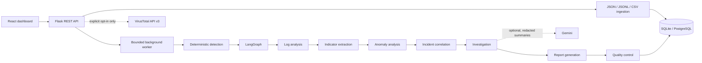

# SentinelAI

**AI-Assisted Security Investigation, Threat Intelligence and Incident Analysis.**

SentinelAI is a defensive, read-only workspace for investigating authorized authentication and application telemetry. It ingests JSON, JSONL, and CSV; normalizes and redacts common credential fields; runs transparent deterministic rules; correlates evidence into candidate incidents; and produces reports linked to stored event IDs. Optional AI notes and threat-intelligence lookups are clearly separated from local detections.

SentinelAI does not exploit systems, scan public address ranges, execute uploaded content or model-generated commands, upload logs to an LLM, or perform response actions. Recommendations are for an analyst to review.

## Features

- Versioned Flask REST API, SQLAlchemy persistence, SQLite for development, PostgreSQL in Compose.
- Bounded background investigation jobs and visible agent trace.
- JSON/JSONL/CSV parsing with upload/row limits, secret-field filtering, and normalized event IDs.
- Deterministic authentication detections with transparent rule IDs and evidence references.
- Candidate incident grouping, severity rationale, chronological timeline, quality checks, and human review.
- Seven LangGraph agent stages for log analysis, indicator extraction, anomaly analysis, correlation, investigation, reporting, and quality control.
- Optional Gemini advisory using only aggregate detection summaries; no raw logs or tool execution access are passed to the model.
- Optional manual VirusTotal lookup for an explicitly authorized, validated indicator. No indicators are queried automatically from logs.
- React + TypeScript dashboard with real API-backed upload, jobs, findings, incident review, and report export.
- Synthetic fixture evaluation and deterministic tests.

## Architecture



## Agent responsibilities

Modules live under `backend/app/agents/`:

1. `log_analyzer.py` summarizes event volume, time range, fired rules, missing fields, and follow-up questions.
2. `threat_intelligence.py` extracts and classifies IP, domain, URL, and hash indicators; it never calls a provider.
3. `anomaly_analyzer.py` flags relative source-IP event frequency. This is an anomaly signal, not a maliciousness probability.
4. `incident_correlator.py` groups related rule findings and creates event timelines.
5. `investigator.py` provides evidence-bound next steps and alternative explanations.
6. `report_generator.py` makes a report with event references, severity rationale, limitations, and human review fields.
7. `quality_controller.py` rejects report references to unknown event or finding IDs.

The deterministic engine runs before the agents. Severity comes from documented rule levels. AI cannot set severity. AI is disabled by default; when enabled, only event counts, finding IDs, and incident references are sent to Gemini. It does not receive raw logs.

## Detection rules

- `AUTH-001`: at least five failed authentications for one source/account pair in ten minutes (high).
- `AUTH-002`: failed authentication from one source against at least three accounts (high).
- `AUTH-003`: successful authentication after at least three failures for the same source/account within fifteen minutes (high).
- `AUTH-004`: successful login with a conventional privileged account name (medium; verify expected use).

These are starter rules, not Sigma-complete support. The implementation does not claim broad production detection coverage.

## Local development

Prerequisites: Python 3.11+, Node 20+, npm.

```powershell
cd sentinel-ai-threat-intelligence
Copy-Item .env.example .env
python -m venv .venv
.\.venv\Scripts\Activate.ps1
pip install -r backend/requirements.txt
cd backend
python run.py
```

In another terminal:

```powershell
cd sentinel-ai-threat-intelligence/frontend
npm install
npm run dev
```

Open `http://localhost:5173`; backend health is `http://localhost:5000/api/v1/health`. On first start, SQLAlchemy initializes missing tables. No real credentials are needed for ingestion, detection, reports, or tests.

## Configuration

Copy `.env.example` to `.env`. Most useful settings:

| Setting | Purpose |
| --- | --- |
| `DATABASE_URL` | Defaults to local SQLite; Compose configures PostgreSQL. |
| `ENABLE_AI_ANALYSIS`, `GEMINI_API_KEY`, `GEMINI_MODEL` | Optional Gemini investigation notes; disabled by default. |
| `THREAT_INTEL_PROVIDER=virustotal`, `THREAT_INTEL_API_KEY` | Optional explicit VirusTotal indicator lookup. |
| `MAX_UPLOAD_BYTES`, `MAX_EVENTS_PER_DATASET` | Upload and processing bounds. |
| `MAX_JOB_DURATION_SECONDS` | Maximum accepted background analysis duration. |
| `CORS_ALLOWED_ORIGINS` | Explicit frontend origin allowlist. |

Keep `.env` private. API keys are only read by the backend and are never included in the React build.

## Threat intelligence and privacy

The adapter uses VirusTotal API v3 report endpoints for IP addresses, domains, hashes, and URLs. Completed and not-found results are cached locally for 24 hours. Lookups are never automatic. The frontend requires an analyst-triggered lookup and displays a disclosure notice. VirusTotal documents that querying an indicator via the API adds it to its dataset; do not submit confidential, sensitive, or personal indicators. See the official [IP address report](https://docs.virustotal.com/reference/ip-object), [domain report](https://docs.virustotal.com/reference/domain-info), [URL report](https://docs.virustotal.com/reference/url-info), and [file report by hash](https://docs.virustotal.com/reference/file-info) documentation. The project only reads reports; it never uploads files or scans URLs.

## Docker Compose

After configuring `.env`, run:

```powershell
docker compose up --build
```

PostgreSQL is not published to the host. The backend waits for the database health check, and database data persists in a named volume. Redis is not used; a bounded local thread worker persists job status but does not resume an in-progress job after process restart. Compose is for development, not a hardened production deployment.

## API quick reference

- `GET /api/v1/health`, `GET /api/v1/overview`
- `POST /api/v1/datasets` multipart field `file`; `POST /api/v1/datasets/sample`
- `GET /api/v1/datasets?page=1&limit=25`, `GET /api/v1/datasets/{id}/events`
- `POST /api/v1/datasets/{id}/analyze`; poll `GET /api/v1/jobs/{job_id}`
- `GET /api/v1/datasets/{id}/findings`, `GET /api/v1/incidents`
- `GET /api/v1/incidents/{id}`, `GET /api/v1/incidents/{id}/report`
- `POST /api/v1/incidents/{id}/review` with a decision and note
- `POST /api/v1/intelligence/lookup` with `dataset_id`, `kind`, `value`, and `authorized: true`
- `GET /api/v1/jobs/{id}/trace`

See [docs/api.md](docs/api.md) for request and response examples.

## Tests and evaluation

```powershell
cd sentinel-ai-threat-intelligence/backend
python -m pytest
cd ..
python evals/run_evaluations.py
```

Tests use local synthetic data and mocked integrations; they make no provider requests. Evaluation runs actual detection, correlation, and report-reference checks against one synthetic authentication fixture. Results are written to `evals/results.json` and `evals/REPORT.md`. Those fixture metrics are not real-world performance estimates.

## Security, privacy, and limitations

- This is a restricted single-user local mode; there is no authentication, authorization, or tenant isolation. Do not expose it to untrusted networks.
- Uploads are parsed in memory and normalized fields are stored in the database; source files are not saved or executed. Common secret-named fields and assignment patterns are redacted.
- No log message content is sent to an external LLM. Optional AI receives only detection summaries.
- External threat-intelligence lookup is opt-in and limited to validated indicators. Private/reserved IPs are blocked. Logs are not submitted automatically.
- Jobs run in a bounded in-process thread pool and are marked interrupted on startup if they were running; use a durable queue for multi-instance production.
- SQLite table creation is supported locally. Alembic migrations, retention policies, and authenticated audit identities are not yet implemented.
- Isolation Forest and full Sigma support are not implemented. The anomaly agent uses a simple relative-frequency baseline.
- DNS/network egress is not used to fetch URLs found in logs; URL indicators are only submitted as encoded IDs to the configured VirusTotal endpoint after explicit confirmation.
- The local tests and synthetic metrics do not establish security efficacy.

For future deployment guidance, see [docs/security.md](docs/security.md) and [docs/architecture.md](docs/architecture.md). Screenshots will be added after real UI capture.
